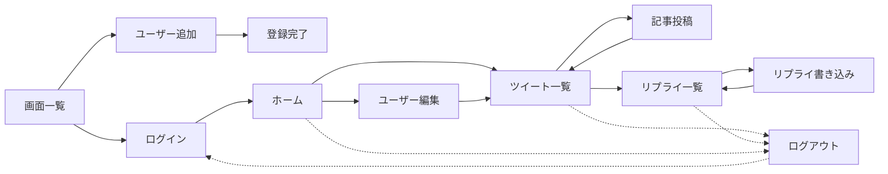
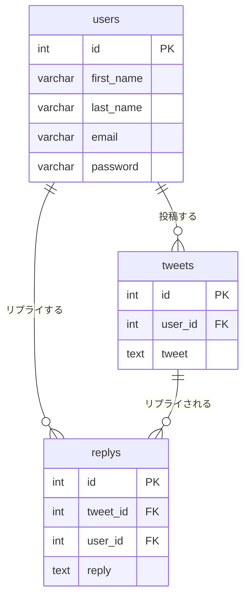

# PHPouyo

PHP 応用の課題として作成した、Twitter ライクな **ツイート投稿・リプライアプリ** です。
フレームワークを使わず、素の PHP（PDO + セッション）で実装しています。

課題の指定環境は **XAMPP** でしたが、XAMPP で発生したエラーや証明書まわりの信頼性に不安があったため、自己学習として **Docker（Nginx + PHP-FPM + MySQL）** でも同じアプリを動かせるようにしました。

| フォルダ | 内容 |
| --- | --- |
| [XAMMP-PHP/](XAMMP-PHP/) | 課題提出用。XAMPP（Apache + MySQL）で動かす版 |
| [Docker-PHP/](Docker-PHP/) | 自己学習。Docker Compose で動かす版 |

## 主な機能

| 画面 | ファイル | 内容 |
| --- | --- | --- |
| 画面一覧（TOP） | `index.php` | ログイン / ユーザー追加への入口 |
| ユーザー追加 | `adduser.php` | 姓・名・メール・パスワードで登録（メール重複チェックあり） |
| ログイン | `login.php` | メールとパスワードで認証し、セッションに保存 |
| ホーム | `home.php` | ログイン後の画面。ツイート一覧 / ユーザー編集へ |
| ユーザー編集 | `edituser.php` | ログイン中ユーザーの情報を更新 |
| ツイート一覧 | `tweetList.php` | 全ユーザーのツイートを表示 |
| 記事投稿 | `addcomment.php` | ツイートを投稿 |
| リプライ一覧 | `replyList.php` | 選択したツイートへのリプライを表示 |
| リプライ書き込み | `addReply.php` | 選択したツイートにリプライを投稿 |
| ログアウト | `logout.php` | セッションを破棄してログイン画面へ |

ログイン後の画面は、セッションにユーザー情報がなければ `login.php` へリダイレクトします。

## 画面遷移



## 技術スタック

| | XAMPP 版 | Docker 版 |
| --- | --- | --- |
| Web サーバー | Apache（XAMPP） | Nginx 1.25 |
| PHP | XAMPP 同梱の PHP | PHP 8.1（php-fpm, `pdo_mysql`） |
| DB | MySQL / MariaDB（XAMPP） | MySQL 8.0 |
| DB 接続 | `root` / パスワードなし / `localhost` | `user` / `password` / `mysql`（サービス名） |

- DB アクセスは PDO のプリペアドステートメントを使用
- 出力は `htmlspecialchars()` でエスケープ
- パスワードは課題の仕様に合わせて **SHA-256** でハッシュ化して保存

## ER 図



テーブル定義とサンプルデータは [Docker-PHP/docker/mysql/init.sql](Docker-PHP/docker/mysql/init.sql) にあります（課題で配布された SQL をもとにしています）。

## セットアップ

### XAMPP 版

1. `XAMMP-PHP` フォルダを `C:\xampp\htdocs\` に配置します。
2. XAMPP コントロールパネルで Apache と MySQL を起動します。
3. phpMyAdmin（http://localhost/phpmyadmin）で [init.sql](Docker-PHP/docker/mysql/init.sql) を実行し、`twitter` データベースを作成します。
4. http://localhost/XAMMP-PHP/index.php にアクセスします。

### Docker 版

1. `Docker-PHP` フォルダに `.env` を作成します（リポジトリには含めていません）。

   ```env
   MYSQL_ROOT_PASSWORD=root
   MYSQL_DATABASE=twitter
   MYSQL_USER=user
   MYSQL_PASSWORD=password
   ```

   PHP 側は `user` / `password` で `twitter` データベースに接続するため、`MYSQL_DATABASE` は `twitter` にしてください（`MYSQL_USER` にはこのデータベースの権限が付与されます）。

2. コンテナを起動します。

   ```bash
   cd Docker-PHP
   docker compose up -d --build
   ```

   初回起動時に `init.sql` が実行され、テーブルとサンプルデータが作成されます。

3. http://localhost:8888/ にアクセスします。

DB を初期化し直したいときは、ボリュームごと削除してから起動します。

```bash
docker compose down -v
docker compose up -d
```

### サンプルユーザー

`init.sql` で以下のユーザーが登録されます（パスワードはすべて `password123`）。

| 名前 | メールアドレス |
| --- | --- |
| John Doe | john@john.com |
| Jane Smith | jane@jane.com |
| Alice Johnson | alice@alice.com |

ほか計 10 名。

## XAMPP 版と Docker 版の違い

アプリのコードはほぼ共通で、主な違いは DB 接続設定です。

```php
// XAMPP 版
$pdo = new PDO('mysql:host=localhost;dbname=twitter;charset=utf8', 'root', '');

// Docker 版（ホスト名は docker-compose.yml のサービス名 mysql）
$pdo = new PDO("mysql:dbname=twitter;host=mysql;port=3306;charset=utf8mb4", "user", "password");
```

Docker 化で学んだこと:

- コンテナ間はサービス名（`mysql`, `app`）で通信するため、`localhost` では DB に届かない
- Nginx は PHP を直接実行できないので、`fastcgi_pass app:9000` で PHP-FPM コンテナに渡す
- `docker-entrypoint-initdb.d` に置いた SQL は **ボリュームが空のときだけ** 実行される
- ホスト側でポート 8000 が使用中だったため、`8888:80` に変更

## 既知の課題

- XAMPP 版の `adduser.php` は登録後に `adduser2.php` へリダイレクトしますが、`adduser2.php` は XAMPP 版に含まれていません（Docker 版にはあります）。
- `home.php` のフォームの送信先が `tweetlist.php`（小文字）になっています。Windows では動きますが、Docker（Linux）ではファイル名の大文字・小文字が区別されるため `tweetList.php` が見つかりません。
- パスワードのハッシュ化は課題仕様の SHA-256 です。実運用では `password_hash()` / `password_verify()` を使うべきです。
- DB の接続情報を各ファイルに直接書いているため、共通ファイルや環境変数にまとめる余地があります。
